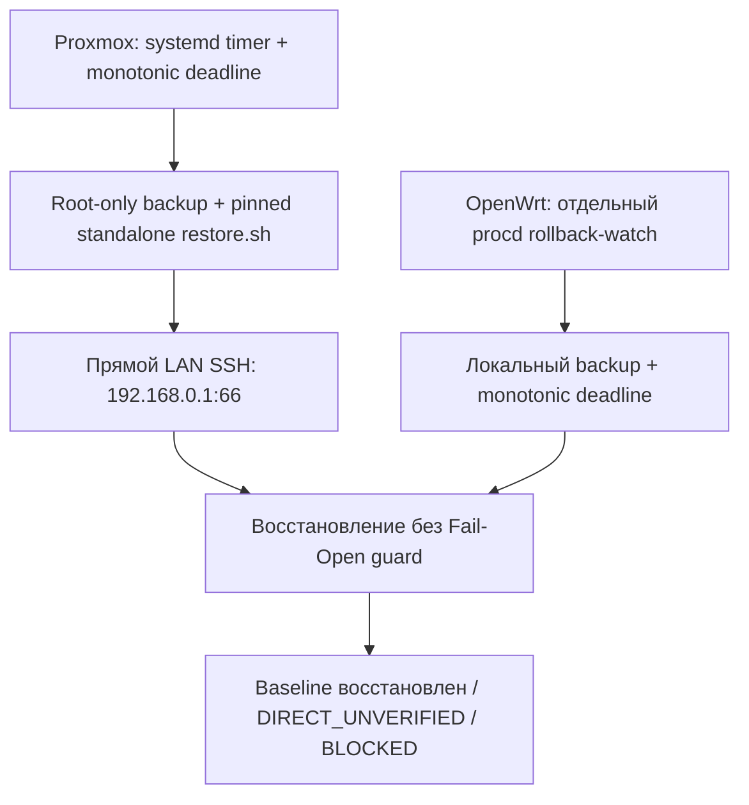

# R12: независимое аварийное восстановление VM202

> Для полного отказа гостя предпочтителен host offline recovery (вариант B), которого
> этот SSH-прототип не реализует. [Фактический Proxmox, изоляция стенда, A/B/C и STOP/GO](proxmox-lab-architecture.ru.md).

**PRODUCTION NO-GO. PR #7 нельзя устанавливать или merge.**
Владелец находится далеко от сервера; открытая Console/SSH-сессия не является
независимым каналом, если её транспорт использует тот же WAN. Старый план
[Fail-Open](fail-open.ru.md) и его rollback, использующий новую библиотеку,
не удовлетворяют этому требованию и заменены настоящими воротами безопасности.

Подготовлены исходники и локальный модельный стенд. Ничего не установлено на
Proxmox/VM202, не изменены cron, автозапуск, DNS, firewall, маршруты или ключи.
**Работоспособность recovery на реальной VM/полноценном OpenWrt-стенде не доказана.**

## Архитектура и границы независимости



Proxmox не использует Codespaces, CT107, Tailscale, DNS, GitHub или WAN для таймера
и локальной копии. Единственный реализованный транспорт в гостя — LAN SSH;
он должен быть заранее авторизован и проверен с самого Proxmox. Это **не**
SSH alias из Codespaces и **не** инфраструктурный MCP inventory.

OpenWrt watcher — отдельная procd-служба, собственные lock/state/backup в
`/etc/podkop-emergency`. Она не вызывает новый guard, его библиотеку/init или
его backup. Остановить неисправный guard пытается через штатный ubus/procd API.
Нет global flush, network/firewall restart, остановки VM, изменений Dropbear,
Tailscale или ZeroTier. Рестарты sing-box/dnsmasq при реальном откате всё же нужны;
они допустимы только после отдельного разрешения на соответствующий этап.

Локальные монотонные deadlines сверяются каждые пять секунд. Они не зависят от
NTP, времени Asia/Yekaterinburg и пользовательского терминала. При смене boot_id
незавершённая операция становится просроченной, но настоящая boot race S94/S99
**не проверена** и остаётся BLOCKER. Host timer использует OnBootSec=15s и
OnUnitInactiveSec=5s, AccuracySec=1s; Persistent=true не используется: для этих
монотонных timers он не даёт catch-up после reboot. См.
[systemd.timer](https://www.freedesktop.org/software/systemd/man/latest/systemd.timer.html).

## Точный состав подготовленного комплекта

| Исходник | Место установки ПОСЛЕ разрешения | Назначение |
|---|---|---|
| [openwrt-rollback.sh](../scripts/rollback/openwrt-rollback.sh) | VM: `/usr/sbin/openwrt-emergency-rollback`; Proxmox: `/usr/local/libexec/openwrt-emergency-rollback` | Самостоятельный capture/import/verify/arm/check/restore/confirm |
| [openwrt-rollback-watch.sh](../scripts/rollback/openwrt-rollback-watch.sh) | VM: `/usr/sbin/openwrt-rollback-watch` | Локальный scheduler без SSH/сети |
| [openwrt-rollback.init](../scripts/rollback/openwrt-rollback.init) | VM: `/etc/init.d/openwrt-emergency-rollback` | Отдельный procd supervisor |
| [proxmox-rollback.sh](../scripts/rollback/proxmox-rollback.sh) | PVE: `/usr/local/sbin/proxmox-rollback-202` | Host deadlines, независимая копия, повторная доставка engine/bundle |
| [proxmox-rollback-watch.sh](../scripts/rollback/proxmox-rollback-watch.sh) | PVE: `/usr/local/libexec/proxmox-rollback-watch` | Проверка локальных pending операций |
| [proxmox-rollback.service](../scripts/rollback/proxmox-rollback.service), [timer](../scripts/rollback/proxmox-rollback.timer) | PVE: `/etc/systemd/system/` | Service/timer без network-online dependency |
| [ssh.conf.example](../scripts/rollback/ssh.conf.example) | PVE: `/etc/podkop-emergency-202/ssh.conf` | Шаблон, не готовая авторизация |

На PVE нужны имеющиеся bash/systemd/OpenSSH/flock/coreutils timeout/sha256sum;
в OpenWrt — ash, procd/ubus, jq, nft, ip, UCI, flock с `-w`, tar с `-tf/-xf`,
sha256sum, readlink, od/head, writable storage. Новых пакетов сейчас не ставили.
Права: каталоги/исполняемые скрипты0700, config/state/archive0600; umask077.
Копии содержат VPN-секреты: их нельзя переносить в Git, отчёт или вложения.

Исходники — прототип фиксированного VM202 IPv4-профиля, а не общий установщик.
Нет автоматически устанавливаемой службы, ключа, VPN или открытого порта.

## Что именно сохраняется и восстанавливается

Capture ничего не активирует: сохраняет Podkop/DHCP/sing-box/network/firewall UCI,
скомпилированный sing-box JSON, native init Podkop/sing-box/dnsmasq/cron, updater
wrapper/.real.sh, lists guard, root cron, точные autostart symlinks этих служб,
наличие/отсутствие новых Fail-Open файлов. Отдельно сохраняет PodkopTable,
IPv4/IPv6 routes/rules и fw4 для аудита. SSH/Tailscale/ZeroTier файлы и symlinks
не входят в изменяемый набор.

**Важно:** read-only сверка VM выявила локальные rule_set:
`/tmp/sing-box/rulesets/{USA-user-domains,main-user-domains,main-user-subnets}-ruleset.json`.
Capture включает реальные локальные rule_set из JSON, строго внутри
`/tmp/sing-box/rulesets/`. Remote rule_sets/другие пути отвергаются: офлайн-старт
для них не подтверждён. Один JSON без этих файлов — недостаточный backup.
Нужны запас свободного места минимум 3 размера комплекта +16MiB и контроль
фактического размера до arm. Полный образ VM/overlay пакетов этот backup не заменяет.

Archive/manifest проверяются до restore. Только одновременное совпадение baseline
health, конкретного SHA256 и ручной команды accept разрешает arm по регламенту;
сам accept технически фиксирует утверждение оператора, не измеряет здоровье сети.
Данные baseline должны быть заново проверены непосредственно перед Stage2.

Restore:

1. Проверяет целостность backup; сверяет защищённые network/firewall файлы.
   Если они изменились или отличается stateless fw4 runtime — STOP/BLOCKER,
   без слепого network restart или fw4 replay. Динамические изменения fw4 также
   могут вызвать консервативный STOP; профиль требует стендовой приёмки.
2. Через ubus удаляет только службу нового guard. Получает отдельный emergency
   lock и control lock с ожиданием не более5s. Повисший процесс/lock → BLOCKER.
3. Создаёт собственный FakeIP reject barrier; удаляет только PodkopTable,
   точные priority105/mark0x100000 rules и local-default route таблицы podkop.
4. Возвращает разрешённые файлы и autostart links, удаляет только явно отсутствовавшие
   файлы нового guard. Никакого рекурсивного удаления чужих каталогов.
5. Проверяет сохранённый native sing-box config и запускает native sing-box init;
   **Podkop start/list download не вызывается**. Восстанавливает сохранённую
   PodkopTable и точное policy rule/route; перезапускает native dnsmasq.
6. Если native sing-box не поднимается — отдельный DIRECT DHCP candidate,
   сохранённый при capture, с DNS1.1.1.1/9.9.9.9 и собственным FakeIP barrier.
   Доступность этих DNS через WAN должна быть отдельно принята на стенде.
7. Выставляет RESTORED_UNVERIFIED или DIRECT_UNVERIFIED. Это **не PASS здоровья
   интернета**, не подтверждение VPN-ключей и не основание для дальнейшего внедрения.

Неполный restore остаётся ARMED, повтор через60s, максимум3 попытки; затем BLOCKED.
Это предел автоматических попыток, а не гарантированное восстановление за3 попытки.
Повторный вызов уже завершённого restore не перезапускает службы повторно.
Host хранит собственные script+bundle SHA256 и при необходимости заново доставляет
оба в VM: повреждение гостевой копии скрипта/backup не требует нового guard.
Если SSH не работает, доставка невозможна — остаётся только заранее работающий
гостевой scheduler. Команды host ограничены timeout40s каждая; это не жёсткая
верхняя граница восстановления сети. Зависания kernel/flash/служб не покрыты.

## Независимое подтверждение

Состояния: CAPTURED/STAGED → ACCEPTED (локальная отметка) → ARMED →
CONFIRMED **либо** RESTORED_UNVERIFIED / DIRECT_UNVERIFIED / BLOCKED.
CONFIRMED выставляется только явной командой владельца после WAN/DNS/LAN/SSH/LuCI/
ZeroTier приёмки. PID/ping/ответ нового guard никогда не отменяет deadline.
Сначала host сохраняет ARMED локально, затем arm гостя. При неудаче второго шага
host остаётся ARMED; **развёртывание запрещено**, таймер не отменять молча.
Confirm проверяет одноразовый token, deadline и boot_id; host подтверждает гостя,
затем себя под host lock. Сбой между ними приводит к консервативному host rollback.
Token хранится root-only, не печатается в логах; передавать его в Git/чат нельзя.
Не пытаться подтвердить с запасом менее60s до deadline.

## Проверка независимости: что доказано и что нет

[Модельный стенд](../tests/test-independent-rollback.mjs) запускает настоящий
OpenWrt ash/UCI и реальные файловые операции/sha256/tar/flock. nft/ip/ubus/init/SSH
транспорт заменены фиксированными mocks; WAN/DNS/Tailscale/новый guard в гостевых
тестах намеренно недоступны как команды. Таймерный dispatcher вызывается отдельным
процессом после завершения arm; это проверка persistent deadline logic, **не**
факт срабатывания реального systemd/procd timer после сетевого обрыва.

| Требование | Результат локальной модели | Что нужно на изолированной VM/стенде |
|---|---|---|
| Нет интернета/DNS/Tailscale | Restore не вызывает эти команды | Физически изолированная WAN, реальный native init/nft/route |
| Podkop/новый guard сломан | Restore не исполняет их; procd удаляет guard | Реально сломанный guard, проверка незатронутого SSH/ZeroTier |
| VS Code отключён | Arm-процесс завершён; новый процесс исполняет deadline | Закрыть клиент, дождаться реальных host/guest timers |
| SSH гостя недоступен | Guest canary/restore не используют SSH; host выдаёт BLOCKER | Заблокировать SSH только тестовой VM, дождаться guest timer |
| Guest backup/engine повреждён | Host protocol доставляет pinned copy и восстанавливает | Настоящий локальный SSH и данные backup на PVE |
| Сбой DNS не блокирует Proxmox | Host path использует IP, без tailnet/ProxyJump | Проверить LAN путь при отключённых WAN/DNS |
| Подтверждение потеряно/опоздало | Deadline не отменяется; token/boot проверяются | Два timers, race confirm/expiry/host reboot |

Здесь нет qemu-system-x86_64 и /dev/kvm; `unshare -n` отказал Operation not permitted.
Полноценного изолированного OpenWrt/PVE стенда в текущем Codespace нет.
**Все правые столбцы остаются BLOCKER для production GO.**

Итог: **15/15 модельных тестов PASS**; systemd units дополнительно разбираются
реальным systemd-analyze в disposable root со stand-in executable. Сам timer
там не запускается. Bootstrap static/IPK/runtime-state и syntax/diff checks PASS.

Локальная команда (ничего не устанавливает):

```sh
OPENWRT_RUNTIME=/tmp/podkop-local-libs node --test --test-concurrency=1 tests/test-independent-rollback.mjs
```

## BLOCKER: необеспеченные аварийные сценарии

1. Прямой SSH PVE→VM202 ранее отвечал Permission denied; работающий Codespace alias
   проходит через другой credential/маршрут. На PVE нет подтверждённой авторизации.
   Нужны существующий разрешённый private key на PVE, public key в Dropbear и
   проверенный host key. **Не копировать Codespace private key**; создание нового
   ключа/изменение authorized_keys требует отдельного согласования, сейчас запрещено.
2. Guest Agent ранее UNAVAILABLE. Нельзя считать guest_status/qm monitor командным
   каналом. serial0 socket имеется, но автоматизированный console login/dispatch
   не проверен. [guest-exec](https://www.qemu.org/docs/master/interop/qemu-ga-ref.html)
   требует именно работающего guest agent, которого нельзя заменить inventory API.
   Инъекция клавиш и mount живого диска не предлагаются.
3. Если одновременно недоступны guest SSH и guest scheduler/procd/ядро — действующего
   автономного канала в гостя нет. Без заранее проверенного QGA/serial recovery,
   отдельного OOB/remote hands либо разрешения на остановку VM с проверенным полным
   восстановлением это **неустранимый BLOCKER**. Такие действия сейчас запрещены.
4. Падение/питание/диск самого PVE, VM kernel hang, rootfs read-only/full, arbitrary
   privileged corruption, убитый scheduler, зависшие native init и внешний firewall
   не покрыты. Root-код guard может повредить и guest rollback: защитой остаётся
   host copy, но ей необходим работающий транспорт в гостя.
5. Поломка network/firewall, посторонние изменения fw4/PBR, live cron races, новые
   IPv6/remote rule_sets, native S99 race после неожиданного reboot не отрабатываются
   вслепую. Network/firewall и чужие routes сохранены для аудита, но их полное
   автоматическое восстановление не реализовано: engine сохраняет их текущими
   и блокирует restore при обнаруженной смене защищённого профиля. Нужен стенд, фиксированный принятый профиль и отдельное решение.
6. DIRECT_UNVERIFIED не гарантирует следующий reboot с исходным Podkop autostart;
   reboot из этого состояния запрещён до отдельного плана/приёмки.
7. После возврата baseline прежний updater снова содержит исторический дефект.
   Rollback восстанавливает известное состояние, не устраняет исходную причину
   навсегда. Нужна последующая согласованная работа, без повторного ночного cron вслепую.

## Stage1: только восстановление, без Fail-Open

**Отдельное согласование Stage1 ещё не получено. Команды ниже не выполнялись.**

| Шаг | GO | STOP |
|---|---|---|
| 1A. Полномочия/стенд | Root на тестовом PVE; изолированная VM без production NIC/MAC/IP/cron | Нет изоляции или нужен доступ к production keys/Remnawave |
| 1B. Транспорт | Direct PVE→guest SSH с pinned key, без ProxyJump/DNS/интернета | Нет авторизации; не создавать ключи автоматически |
| 1C. Capture/host-copy | Комплект целый, rule_sets локальны, свободное место, исходный WAN/VPN/DNS проверены | Неизвестные rules/сервисы/IPv6, неполный backup |
| 1D. Canary | Реальные два timer срабатывают при отключённом клиенте/WAN, только запись marker | Таймер зависит от terminal/сети или не переживает service-manager restart |
| 1E. Restore на стенде | Все fault-сценарии ниже завершаются исходным WAN/DNS и доступом | Любой непроверенный сценарий, зависание/неполный rollback |
| 1F. Production rollback-only | ПОСЛЕ разрешения: только backup/rollback-tools, штатный Podkop/autostart не трогать | Нет подтверждённого транспорта/локального timer или полевого протокола приёмки |

Для стенда нужны существующий резервный OpenWrt или отдельно согласованная clone VM
на изолированных bridges, без WAN bridge production и без существующих VPN/Remnawave
ключей. Полный образ/конфигурация VM202 содержит секреты — не экспортировать в Git.
Точные команды создания clone не даются вслепую: нужны доступные storage/VMID,
способ изоляции и отдельное разрешение. Production VM202 для стенда не останавливать.

### Установка rollback-only после разрешения

На VM из заранее проверенного локального каталога R12 rollback-only (НЕ весь PR):

```sh
: "${R12_STAGE1_APPROVED:?Нужно отдельное разрешение Stage1}"
umask 077
mkdir -p /etc/podkop-emergency
chmod 700 /etc/podkop-emergency
# Сначала backup любых существующих одноимённых файлов; при наличии — STOP.
test ! -e /usr/sbin/openwrt-emergency-rollback
test ! -e /usr/sbin/openwrt-rollback-watch
test ! -e /etc/init.d/openwrt-emergency-rollback
cp /tmp/r12-rollback/openwrt-rollback.sh /usr/sbin/openwrt-emergency-rollback
cp /tmp/r12-rollback/openwrt-rollback-watch.sh /usr/sbin/openwrt-rollback-watch
cp /tmp/r12-rollback/openwrt-rollback.init /etc/init.d/openwrt-emergency-rollback
chmod 700 /usr/sbin/openwrt-emergency-rollback /usr/sbin/openwrt-rollback-watch /etc/init.d/openwrt-emergency-rollback
/etc/init.d/openwrt-emergency-rollback enable
/etc/init.d/openwrt-emergency-rollback start
```

На PVE — ПОСЛЕ настройки **существующей** SSH-авторизации и проверки fingerprint
SHA256:zvypgX4XqDMQTdDdFHBGpLZ6jCeMpIbGxIN6xxbevO4 доверенным каналом:

```sh
: "${R12_STAGE1_APPROVED:?Нужно отдельное разрешение Stage1}"
set -eu
umask 077
mkdir -p /etc/podkop-emergency-202 /var/lib/podkop-emergency-202 /usr/local/libexec
chmod 700 /etc/podkop-emergency-202 /var/lib/podkop-emergency-202
# STOP, если перечисленные целевые файлы уже существуют; сохранить их backup.
test ! -e /usr/local/sbin/proxmox-rollback-202
test ! -e /usr/local/libexec/openwrt-emergency-rollback
test ! -e /usr/local/libexec/proxmox-rollback-watch
test ! -e /etc/systemd/system/proxmox-rollback.service
test ! -e /etc/systemd/system/proxmox-rollback.timer
cp /root/r12-rollback/proxmox-rollback.sh /usr/local/sbin/proxmox-rollback-202
cp /root/r12-rollback/proxmox-rollback-watch.sh /usr/local/libexec/proxmox-rollback-watch
cp /root/r12-rollback/openwrt-rollback.sh /usr/local/libexec/openwrt-emergency-rollback
cp /root/r12-rollback/proxmox-rollback.service /etc/systemd/system/
cp /root/r12-rollback/proxmox-rollback.timer /etc/systemd/system/
chmod 700 /usr/local/sbin/proxmox-rollback-202 /usr/local/libexec/proxmox-rollback-watch /usr/local/libexec/openwrt-emergency-rollback
test -f /etc/podkop-emergency-202/ssh.conf
test -f /etc/podkop-emergency-202/known_hosts
systemd-analyze verify /etc/systemd/system/proxmox-rollback.service /etc/systemd/system/proxmox-rollback.timer
systemctl daemon-reload
systemctl enable --now proxmox-rollback.timer
```

После проверки supervisor status оба canary получают **собственные** IDs, например
`canary_guest_A` и `canary_host_A`:

```sh
# В VM, только локальные marker/state, никакого restore:
/usr/sbin/openwrt-emergency-rollback arm-canary canary_guest_A 60
# На PVE, без SSH для этого canary:
/usr/local/sbin/proxmox-rollback-202 arm-canary canary_host_A 60
```

Разорвать клиентское соединение со стендом, отключить его WAN, не выключая host.
Через >65s локально/с независимого стендового канала проверить CANARY_FIRED.
Этого недостаточно для production GO: дальше полные restore-сценарии на стенде.

Capture/доставка **ещё не arm и не включение Fail-Open**:

```sh
# VM; уникальный ID, только снимок:
/usr/sbin/openwrt-emergency-rollback capture deployment_A
/usr/sbin/openwrt-emergency-rollback verify deployment_A
# PVE; скачивает только локальный backup через LAN:
/usr/local/sbin/proxmox-rollback-202 stage deployment_A
# После измеренной приёмки baseline, зафиксировать конкретный SHA без секретов:
BUNDLE_SHA=$(sha256sum /var/lib/podkop-emergency-202/deployment_A/bundle.tar | awk '{print $1}')
/usr/local/sbin/proxmox-rollback-202 accept deployment_A "$BUNDLE_SHA"
```

Без accept/timers/host transport — STOP. Проверить целостность host и guest copies,
сверить rc.d links и routes, выполнить restore на **стенде**, а не на VM202.

### Обязательная стендовая приёмка Stage1

Для каждого сценария измерить start/finish, raw health сохранить локально без
секретов, получить LAN DNS/HTTP/HTTPS, SSH/LuCI и сохранность чужих маршрутов/fw4:

1. Успешный baseline rollback без установки guard (контроль).
2. Подписка/guard/lib/init испорчены, sing-box остановлен; rollback не читает их код.
3. Нет WAN/DNS/Tailscale и закрыт VS Code: оба timers действительно срабатывают;
   после возврата тестового WAN штатный доступ восстанавливается.
4. Guest SSH недоступен: реальный guest scheduler возвращает профиль без host SSH.
5. Guest engine/backup удалены: host LAN SSH заново доставляет pinned copy.
6. Истёк deadline, неверный/поздний confirm; host/guest confirm race.
7. Native service/nft/диск/lock failure на каждой границе: отсутствие ложного PASS,
   ограниченные retries; каталог backup остаётся. Неразрешимые варианты → BLOCKER.
8. Перезапуск supervisors/host reboot/guest reboot на **стенде** — отдельно;
   координация S94/S99 и deadlines. Production reboot запрещён.

## Stage2: Fail-Open — только после принятого Stage1

Сейчас **STOP**, команды старого плана не выполнять.
GO возможен после документированной приёмки правых столбцов, решения BLOCKER1–3,
нового baseline capture и отдельного разрешения владельца на конкретное окно.

1. Прямо перед изменениями на PVE arm `deployment_A 900`; проверить ARMED обоих
   clocks, token сохранён на PVE, реальные timers активны. До этого — никаких
   изменений native autostart, updater, guard, DNS/nft/routes.
2. Выполнять только заранее согласованный ограниченный набор изменений; никаких
   дополнительных исправлений «по месту». При ошибке или потере связи **не confirm**.
3. Проверять с независимого LAN-клиента WAN/DNS/HTTP/HTTPS и SSH/LuCI/ZeroTier.
   Успех нового guard сам по себе не является подтверждением.
4. Явный host confirm с локально прочитанным token только после полной приёмки,
   с запасом >60s. Если владелец/VS Code/интернет недоступны — confirm не поступает,
   timers пытаются автономный rollback по проверенному стендовому сценарию.
5. RESTORED_UNVERIFIED/DIRECT_UNVERIFIED/BLOCKED → STOP, никаких новых внедрений
   и reboot; требуется проверка через заранее принятый независимый канал.

Снять rollback-only комплект можно лишь при отсутствии ARMED cases и после
отдельного разрешения. Отключать timers, удалять backup или восстанавливать firewall
«целиком» при незавершённом внедрении запрещено.

## Что конкретно требуется согласовать дальше

1. Доступ root на существующем PVE для локальной установки rollback-only: нынешний
   read-only MCP не исполняет shell. Ни новая MCP-служба, ни новый сетевой сервис не нужны.
2. Проверка имеющейся PVE SSH identity и host-key pinning. При отсутствии подходящего
   ключа — отдельное разрешение на host identity и public-key enrollment в VM;
   сейчас это не выполнено и не подразумевается разрешённым.
3. Предоставление существующего изолированного стенда либо отдельное разрешение
   на тестовую VM с выбранными VMID/storage/bridges. VM201 и production NIC не трогать.
4. Отдельное разрешение Stage1: только snapshot, host copy, rollback-only tools и
   marker canaries на production после стенда; никаких изменений штатного Podkop/DNS.
5. Решение владельца по отсутствующему каналу при SSH+guest-scheduler отказе.
   QGA/serial требуют технической проверки и могут потребовать изменения VM;
   OOB/remote hands или stop/restore также не существуют автоматически и не разрешены.
6. Только после протокола приёмки Stage1 — отдельное разрешение Stage2. До этого
   PR остаётся Draft/NO-GO независимо от количества прошедших локальных тестов.
