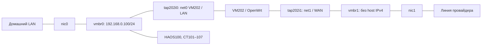
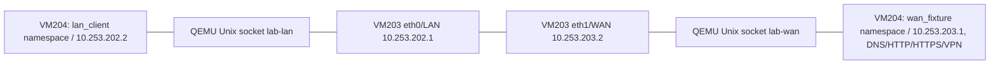

# R12: фактический Proxmox и архитектура стенда — 23.11.2026

**Draft PR7 / PRODUCTION NO-GO.** Только read-only SSH `proxmox-cloud` и документация.
VM202 работает и не изменялась; VM201 не использовалась. Не выполнялись create,
clone, snapshot, restore, start/stop/reboot, установка пакетов, изменение bridge,
firewall, routing, SSH, ключей или systemd. Тесты повторно не запускались.

## Дополнение: root Shell владельца, 23.11.2026

Источник — предоставленный владельцем вывод read-only команд; агент root-команды
не выполнял. Эти сведения заменяют прежние отметки «не проверено» ниже.

- VM202: boot=c, RAM512MiB; scsi0=local-lvm:vm-202-disk-0,size=2G,
  scsihw=virtio-scsi-pci. net0=virtio/vmbr0 (LAN), net1=e1000/vmbr1 (WAN).
- QGA: «No QEMU guest agent configured», exit255. Это отсутствие настройки,
  не доказательство зависания гостя. Не использовать QGA как доступный recovery path.
- serial0=socket; /run/qemu-server/202.serial0 существует root:root0750.
  Наличие socket не доказывает guest getty, авторизацию или восстановление kernel.
- Cluster nextid=108; явные запросы VMID203 и204 вернули203/204: свободны на момент
  проверки, НЕ зарезервированы. Перед будущим созданием проверить повторно.
- local-lvm/pve:data и extra-storage/extra-storage:nvme-pool разрешают images/rootdir.
  local разрешает только vztmpl,iso,import,backup; backups-seagate — только backup.
- Последующая root-диагностика владельца: extra-storage Data9,62%, Meta13,90%, rw;
  local-lvm Data58,72%, Meta2,37%, rw. BLOCKER по заполнению/доступности LVM снят.
- pve-cluster active, одиночный Proxmox: кластерный quorum не является отдельным
  препятствием стенду. Это не испытание потери WAN или отказа host storage.

**До разрешения на создание LAB — STOP:** осталось установить физическое backing
extra-storage и проверить установленный QEMU/PVE Unix-socket backend. Ресурсы:
203=OpenWrt1vCPU/1GiB/4GiB,204=fixture1vCPU/1GiB/4GiB, резерв32GiB extra-storage.
Снятие LVM gate не разрешает создание VM и не подтверждает автономный recovery.

### Минимальная оставшаяся read-only проверка (root Shell владельца)

```sh
pvs --readonly -o pv_name,vg_name,pv_size,pv_free --select 'vg_name=extra-storage'
lsblk -e 7 -o NAME,TYPE,SIZE,MODEL,TRAN,PKNAME,MOUNTPOINTS
qemu-system-x86_64 --version
qemu-system-x86_64 -netdev help
```

PV→lsblk→parent disk позволяет установить физическое backing без чтения данных,
серийных номеров и UUID. Если PV находится на dm/md, проследить всю цепочку parents;
название VG не доказывает отдельный физический диск или failure domain.
QEMU help подтверждает только наличие stream/socket backend, не Unix-синтаксис и
не корректность PVE args. Следующий безопасный шаг — сверить установленную локальную
man qemu-system-x86_64 (разделы netdev stream/socket, addr.type=unix) с этой версией.
Не запускать QEMU с socket/listener, не создавать dummy VM для проверки. До разрешённого
LAB фактическая интеграция остаётся UNVERIFIED; qm showcmd возможен лишь после отдельного
разрешения создать изолированную конфигурацию LAB. Отсутствие stream или Unix support
означает STOP, без подмены на production bridge.

## Подтверждено предыдущим SSH

| Объект | Результат |
|---|---|
| Узел / учётная запись | podvoz-beelink, codexops UID1001, не root и не группа kvm |
| CPU / память | 4 logical CPU; RAM31864MiB, available16563MiB; load2.69/2.08/1.95 |
| KVM / QEMU | /dev/kvm присутствует; qemu-system-x86_64/kvm/qemu-img установлены. codexops не может использовать KVM напрямую |
| VM | 100 HAOS running8192MiB; 201 OpenWrt stopped512MiB; 202 OpenWrt running512MiB/2GiB |
| CT | 101–107 running, включая107 tailscale-bastion |
| Кандидаты VMID | 203/204 подтверждены свободными root API на момент проверки; НЕ зарезервированы |
| extra-storage | active lvmthin; Available903760666KiB ≈862GiB |
| local-lvm | active lvmthin; Available150985939KiB ≈144GiB |
| local | active dir; Available55634572KiB ≈53GiB, /var/lib/vz на root ext4 |
| backups-seagate | active dir; Available259749856KiB ≈248GiB; независимый физический носитель по имени НЕ доказан |
| systemd | timers.target active, systemd-run и timeout установлены; запуск job/units не выполнялся |
| Сетевые backends QEMU | help перечисляет stream/socket/dgram/hubport/tap/user/passt/bridge; гости этим запросом не запускались |

Права sudo: только qm list, pct list, pvesm status и фиксированные wrappers.
`codexops-guestctl --help` сообщает plan/apply start/reboot CTID — это НЕ интерфейс
чтения VM config/QGA. Никакие start/reboot не вызывались. Читать его код запрещают
Unix permissions. Не расширялись права и не создавались новые MCP.

## Реальная схема сети



bridge-ports в /etc/network/interfaces: vmbr0→nic0, vmbr1→nic1. Текущие sysfs brif
подтверждают tap202i0/vmbr0 и tap202i1/vmbr1. Роль WAN/LAN сопоставлена с ранее
проверенной OpenWrt eth1/WAN и br-lan/LAN; новое qm config прочитать не удалось.
PVE default route: 192.168.0.1 через vmbr0. Поэтому его внешний доступ зависит от
VM202, но локальные systemd, QEMU и диски — не от этого gateway.
Docker bridges172.17–20 присутствуют; НЕ являются принятым изолированным стендом:
их firewall/NAT и связь с host production не исследовались и не меняются.
nic2 есть лишь в файле конфигурации, среди текущих link не обнаружен.

## Неполученные сведения — не подменять догадками

- PVE→OpenWrt по LAN: root@192.168.0.1:66 из контекста codexops не прошёл strict
  host-key checking: нет записи known_hosts. Авторизация ключом НЕ дошла до проверки.
  Исторический root-shell PVE ранее получал Permission denied(publickey).
  Это разные контексты; рабочий постоянный host credential не подтверждён.
- VM202 config/serial sockets не читаются codexops. Ранее владелец подтвердил
  serial0:socket и QGA unavailable; в этой проверке актуальное состояние QGA
  не проверено. Serial не равен проверенному автоматическому console recovery.
- pvesh /cluster/nextid не смог загрузить ACL в текущем непривилегированном
  контексте (IPC error). Это НЕ доказательство поломки PVE: sudo inventory работает.
  jq на PVE также не установлен; ничего не устанавливалось.
- Content=images, thin-pool metadata, конфигурация VM202 boot disk/controller,
  независимость backup storage и root-права для offline disk switch не проверены.

Следующие **только read-only** команды нужны через уже доверенный root-контекст;
доступ к нему/узкий разрешённый интерфейс следует согласовать, не обходить sudo:

```text
qm config 202                 # вывести только agent/serial/net/disk/boot поля
qm agent 202 ping             # ответ агента, не exec и не shutdown
pvesh get /cluster/nextid
pvesm config                 # вывести только type/content/path/pool, не credentials
lvs -o lv_name,vg_name,lv_size,data_percent,metadata_percent
pvecm status                  # если узел кластерный; проверить quorum при потере WAN
```

## Изоляция стенда БЕЗ изменения host bridges/firewall/routes

Предлагаются ДВЕ новые VM, а не clone VM202: чистые проверенные образы без рабочих
VPN-подписок/ключей, SSH private keys, root credentials или production backup.
VM201 не используется. Ресурсы-кандидаты:

- VM203 OpenWrt: 1vCPU, 1024MiB, новый самостоятельный диск4GiB extra-storage.
- VM204 fixture Linux: 1vCPU, 1024MiB, новый диск4GiB; DNS/HTTP/HTTPS origins,
  синтетический VPN endpoint и LAN client внутри разных network namespaces.
- Резерв32GiB thin-pool под образы, чистый baseline, fault disks и повторные прогоны.
  Content=images и свободные VMID подтверждены; LVM gate снят по root-диагностике владельца.
- Лимит CPU каждой тестовой VM0.5 CPU, суммарно≤1 CPU; небольшие I/O limits только
  тестовых дисков. Ресурсы/приоритет VM202 не менять; отложить запуск при нагрузке.



Почему namespaces внутри VM204: если обе стороны находятся в одном Linux network
namespace, запрос к собственному WAN IP может пройти через local route, минуя
OpenWrt. Это не доказательство транзита. Нужны две раздельные таблицы маршрутов.

Два локальных Unix stream backends QEMU, только между этими VM, вместо TAP/bridge.
Каталог sockets под /run с root0700; ни TCP listen/hostfwd, ни SLIRP/user/passt/NAT,
ни NIC passthrough, ни подключения vmbr0/vmbr1/Docker bridges. Существование stream
backend подтверждено бинарником, но корректность конкретных PVE args ещё требует
проверки. [QEMU network backends](https://www.qemu.org/docs/master/system/devices/net.html)
поддерживают guest-to-guest соединения; версия/параметры установленного PVE требуют
своей проверки. Не переносить пример последней QEMU docs вслепую.

План первого запуска ПОСЛЕ разрешения: сначала VM вообще без NIC, управление через
serial/QGA только тестовой VM; назначить отдельные MAC и lab IP. Далее root должен
проверить `qm showcmd <LAB_VMID> --pretty`: только ожидаемые Unix sockets, нет
TAP/slirp/hostfwd/production NIC. Подключать две lab сети только после этого.
Проверить отсутствие production MAC/IP/DHCP, host netdev и маршрутов до/после.
Недопустимый/неподдерживаемый args → STOP; не переходить на production bridge.

## Три варианта полного восстановления

| Вариант | Guest SSH/kernel/procd/QGA | Зависимость от PVE | Оборудование/WAN | Предел |
|---|---|---|---|---|
| A: guest rollback + host SSH | Нужен живой guest kernel и либо local scheduler, либо SSH; QGA не обязателен | Host SSH требует живого PVE | Тот же switch/NIC/ISP | При SSH+procd+QGA отказе и отсутствии локального runner автоматического канала нет |
| B: host offline VM recovery | Не нужны SSH/procd/QGA гостя; PVE принудительно останавливает неисправную VM перед disk switch | Нужны host kernel, systemd, QEMU control, доступный local storage/pmxcfs/quorum | Существующие NIC/switch/ISP остаются общими | Не покрывает отказ PVE/диска/NIC/питания/ISP; cold-boot downtime надо измерить |
| C: физически отдельный резервный router | Не зависит от guest OS и PVE; второй router обязан иметь собственный контроль/fencing | Не нужен PVE, если резерв НЕ VM на этом же хосте | Нужны отдельное питание/порты; switch/ISP могут остаться общими | Не подтверждены наличие устройства, WAN lease/MAC/PPPoE/VLAN условия, DHCP/ARP split-brain и автоматическое fencing |

Если SSH, procd и QGA одновременно не работают, A не помогает. Даже живая serial
консоль не исправляет зависшее ядро автоматически. B может восстановить диск и
перезапустить гостя без гостевого участия, но это требует разрешения на forcible
stop, проверенного offline image и работающего PVE. C переживает отказ самого PVE
только при реально отдельном устройстве; резервная VM на PVE такой независимости
не имеет. Сам по себе второй router не означает безопасное автопереключение.

## Предпочтительный вариант: B, с A только для мягких отказов

Для **полного отказа именно VM202 при живом PVE** минимальное изменение сети —
host-controlled fencing и переключение VM202 на заранее подготовленный локальный
rescue disk. Существующие MAC, VMID, NIC mapping и LAN gateway сохраняются;
VRRP/изменение host bridges или два активных DHCP сервера не требуются.
C — отдельный будущий вариант для отказа самого PVE, сейчас не готов к применению.

Предлагаемый сценарий, НЕ реализованный/не запускавшийся в этом этапе:

1. На PVE заранее хранить проверенный full disk baseline, VM hardware mapping,
   отдельный готовый rescue boot volume и root-only локальный manifest/checksums.
   Rescue для production — не тестовый образ; production secrets не выносятся
   на стенд. Baseline должен уметь boot в DIRECT/WAN с локальным DNS без VPN,
   подписки, загрузки lists, Codespaces или GitHub. Настройки/ключи сохраняются
   локально; неисправный исходный диск не затирается и остаётся для анализа.
2. Systemd job на PVE использует deployment deadline и локальный LAN-свидетель
   (например CT107 через pct exec после отдельной проверки полномочий/утилит).
   Не считать WAN-only outage или один ping основанием для циклического reboot.
3. При отсутствии подтверждения/подтверждённом полном отказе: остановить только
   VM202 через host control с bounded wait; убедиться в завершении QEMU и освобождении
   диска. **Не менять диск работающей VM и не boot второй экземпляр с той же MAC/IP.**
4. Переключить boot на готовый rescue volume; запустить ровно одну VM202. Никакого
   копирования live guest filesystem, mount активного диска или ожидания guest SSH.
   Конкретные qm команды можно составить только после чтения boot/storage config.
5. Проверить LAN DNS/HTTP/HTTPS и WAN через CT107/другой локальный клиент; текущий
   guest PID — не успех. При провайдерском outage сохранить восстановленный DIRECT,
   не зацикливать stops/restores. VPN возвращать позже, после устойчивой проверки.

Целевое время задаётся только по измерению стенда: обнаружение + fencing + disk
switch + boot + LAN приёмка. Сейчас нет оснований обещать 30/60/90 секунд.
Текущий прототип host SSH из PR7 **не реализует B** и не решает зависание ядра.
Уже написанный prototype не расширяется до проверки root/storage/VM возможностей.

## Испытания и этапы: STOP/GO

1. **RO gate (сейчас STOP):** LVM и singleton PVE подтверждены; осталось проверить
   физическое backing storage и Unix-socket совместимость. ID проверять перед allocation. Запусков нет.
2. **Отдельное разрешение LAB:** создать только203/204 с fresh disks и без NIC;
   проверить custom QEMU Unix backend/no-leak до подключения lab NIC. Затем DNS,
   DHCP и реальный HTTP/HTTPS транзит между двумя fixture namespaces.
3. **Recovery LAB:** мягкий отказ; SSH+procd+QGA unavailable; guest kernel hang;
   повреждённый lab disk; оборванный клиент; недоступный lab WAN; timeout fencing;
   отказ/коррупция rescue volume. Проверить один активный router, сохранность fault
   disk, отсутствие restart loop, измеренное downtime. Ни один тест не на VM202.
4. **Recovery-only production — отдельное разрешение после LAB:** локальный backup,
   rescue preparation и marker canaries; работающий Podkop/native autostart не менять.
   Реальная репетиция cold boot/disk switch VM202 потребует ещё отдельного согласования;
   это нельзя выдавать за «безопасный тест без остановки».
5. **Fail-Open — отдельное разрешение:** только после принятого независимого B recovery,
   конкретного downtime budget, armed host deadline и приёмочного протокола.

BLOCKER: физическое backing extra-storage/backup и Unix-socket интеграция PVE не проверены;
VMID не зарезервированы; QGA отсутствует, serial recovery не испытан; нет принятого live host→guest
credential; нет сетевого стенда и измеренного offline recovery; остановка202 не разрешена;
не доказана загрузка production rescue; нет подтверждённого физического router/OOB.
Отказ самого PVE/питания/ISP вариант B не исправляет. PR7 остаётся Draft/NO-GO.
